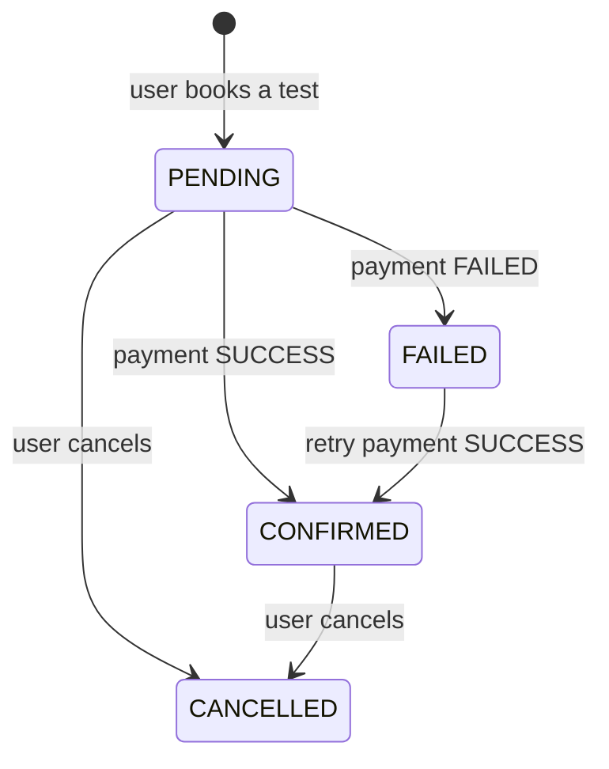
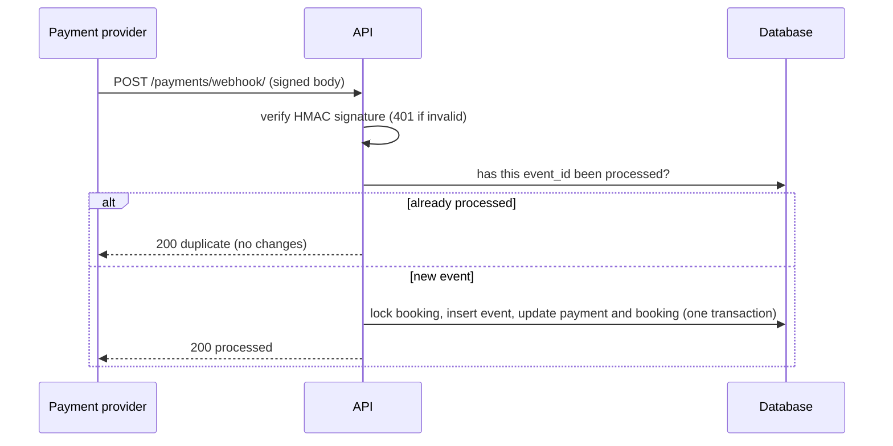
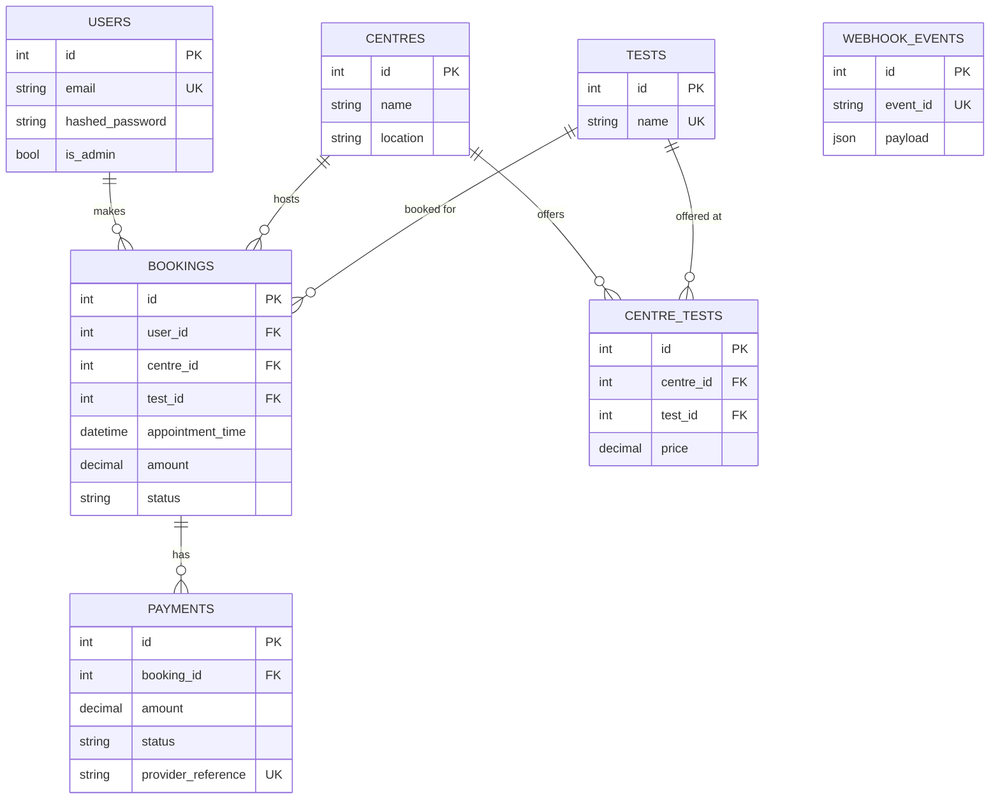

<h1 align="center">🩺 EVE Diagnostics API</h1>

<p align="center">
  Book diagnostic tests, pay with a simulated gateway, and receive <b>idempotent</b> payment webhooks.
</p>

<p align="center">
  
  
  
  
  
</p>

> Backend assignment for **EVE Healthcare (SDE Intern)**. A small service focused on clean API design,
> correct data modelling, and real-world edge cases, with a tested, documented codebase.

---

## ✨ What it does

| | Feature |
|---|---|
| 🔐 | **Auth**: signup, login, JWT, request validation, bcrypt password hashing |
| 🏥 | **Centres & tests**: each centre offers tests at its own price; public, paginated listing |
| 📅 | **Bookings**: book, list, view, cancel; price is snapshotted at booking time |
| 💳 | **Mock payments**: `SUCCESS` / `FAILED`, retry allowed after a failure |
| 🔔 | **Webhook**: HMAC-signed, **idempotent**, safe under duplicate and concurrent delivery |
| 🧪 | **31 automated tests**, run on every push with GitHub Actions |
| 📖 | **Swagger UI** at `/docs`, structured logging, pagination |

## 🔄 How a booking moves



## 🚀 Quick start

### Option A: Docker (PostgreSQL)

```bash
docker compose up --build
docker compose exec api python -m app.seed      # demo centres, tests and an admin user
```

### Option B: No Docker (SQLite, quickest)

```bash
python -m venv venv
venv\Scripts\activate            # Mac/Linux: source venv/bin/activate
pip install -r requirements-dev.txt
```

Then set the database and start the server:

| Terminal | Command |
|---|---|
| Windows CMD | `set DATABASE_URL=sqlite:///./eve.db` |
| PowerShell | `$env:DATABASE_URL="sqlite:///./eve.db"` |
| Mac / Linux | `export DATABASE_URL=sqlite:///./eve.db` |

```bash
python -m app.seed
uvicorn app.main:app --reload
```

Open **http://localhost:8000/docs** 🎉

> Demo admin (created by the seed script): `admin@example.com` / `Admin@12345`

### Run the tests

```bash
pytest -v
```

Tests use an in-memory database, so nothing else needs to be installed or running.

## 🧭 Try it in 2 minutes (Swagger UI)

1. `POST /auth/signup`, then `POST /auth/login`. Copy the `access_token` and click **Authorize**.
2. `GET /centres/` to see centres, tests and prices.
3. `POST /bookings/` with `{"centre_id": 1, "test_id": 1, "appointment_time": "2030-01-15T10:00:00Z"}`.
4. `POST /payments/` with `{"booking_id": 1, "simulate_outcome": "FAILED"}` and copy the `provider_reference`.
5. Send the same webhook twice (the provider signs each request, so use the helper script):

```bash
python scripts/send_webhook.py <provider_reference> evt_1 SUCCESS   # -> processed
python scripts/send_webhook.py <provider_reference> evt_1 SUCCESS   # -> duplicate, nothing changes
```

6. `GET /bookings/1` now shows `CONFIRMED`.

## 🔔 Webhook idempotency



How it stays safe:

- `webhook_events.event_id` has a **UNIQUE** constraint, so one event can only ever be applied once.
- Event insert and state update happen in **one transaction**. Either both happen or neither.
- The booking row is locked (`SELECT ... FOR UPDATE`). If two identical events arrive at the same moment, the second one waits, hits the unique constraint, and returns `duplicate`.
- A **cancelled booking is never resurrected** by a late event.
- Bodies are authenticated with an **HMAC-SHA256** signature in `X-Webhook-Signature`.

## 📚 API

| Method | Path | Auth | Description |
|---|---|---|---|
| POST | `/auth/signup` | n/a | Create account |
| POST | `/auth/login` | n/a | Get JWT |
| GET | `/auth/me` | user | Current user |
| GET | `/centres/` | n/a | Centres with tests and prices (`skip`, `limit`, `location`) |
| GET | `/centres/{id}` | n/a | One centre |
| POST | `/centres/` | admin | Create centre |
| POST | `/centres/{id}/tests` | admin | Offer a test at a centre with a price |
| GET | `/tests/` | n/a | Test catalogue |
| POST | `/tests/` | admin | Create a test |
| POST | `/bookings/` | user | Book a test (`PENDING`) |
| GET | `/bookings/` | user | My bookings (`skip`, `limit`, `status`) |
| GET | `/bookings/{id}` | user | One of my bookings |
| POST | `/bookings/{id}/cancel` | user | Cancel a `PENDING` or `CONFIRMED` booking |
| POST | `/payments/` | user | Simulated payment, `SUCCESS` or `FAILED` |
| POST | `/payments/webhook/` | HMAC | Idempotent provider webhook |
| GET | `/health` | n/a | Liveness check |

Full request and response schemas are in Swagger UI at `/docs`.

## 🗄️ Database design



Why it is shaped this way:

- **`centre_tests`**: the same test can be offered by many centres at different prices. `UNIQUE(centre_id, test_id)`.
- **`bookings.amount` is a snapshot** of the price, so later price changes never rewrite history.
- **`payments` is separate from `bookings`**: one booking can have several attempts (fail, then retry).
- Money is `NUMERIC(10,2)` / `Decimal`, never floats.

## 🛡️ Edge cases handled

| Situation | Result |
|---|---|
| Missing, invalid or expired JWT | `401` |
| Non-admin creating centres or tests | `403` |
| Invalid booking ID, or someone else's booking | `404` (existence is not leaked) |
| Malformed body, bad email, short password, negative price, bad status value | `422` |
| Appointment in the past | `422` |
| Test not offered at that centre | `404` |
| Duplicate signup (case-insensitive email) | `409` |
| Paying a paid or cancelled booking | `409` |
| Failed payment | booking `FAILED`, retry allowed |
| Duplicate or replayed webhook | `200 duplicate`, no state change |
| Unsigned or tampered webhook | `401` |
| Webhook for an unknown payment | `404` |

## 🗂️ Project structure

```
app/
  main.py        app setup, error handler, routers
  deps.py        auth dependencies, webhook signature check
  core/          config, database, security (bcrypt, JWT, HMAC), exceptions, logging
  models/        SQLAlchemy models
  schemas/       Pydantic request/response models
  routers/       thin HTTP layer
  services/      business logic (bookings, payments, webhook)
  seed.py        demo data
scripts/         send_webhook.py (signed webhook helper)
tests/           pytest suite
```

Routers only handle HTTP. Business rules live in `services/` and raise domain errors that
`main.py` turns into HTTP responses. That keeps the logic easy to test and change.

## 📝 Assumptions

- Login is email and password, with short-lived JWT access tokens (no refresh tokens).
- Browsing centres and tests is public. Booking and paying require login.
- Admins are flagged in the database (`is_admin`). Signup can never create one.
- Naive datetimes are treated as UTC.
- `simulate_outcome` on `POST /payments/` exists only to make the mock deterministic for demos and tests.
- Tables are created on startup with `create_all`. A production setup would use migrations.
- Cancelling a `CONFIRMED` booking does not trigger a refund (out of scope).

## 🔭 What I would improve with more time

- Alembic migrations instead of `create_all`.
- Slot and capacity model to prevent double-booking.
- Refunds and a fuller payment state machine (including a `PENDING` payment).
- Retry queue for webhook processing (Celery and Redis) and out-of-order event handling using provider timestamps.
- Rate limiting on auth and webhook endpoints, refresh tokens, email verification.
- Admin endpoints to update or delete centres, tests and prices.
- Run the test suite against PostgreSQL in CI and add a load test for the webhook race.
